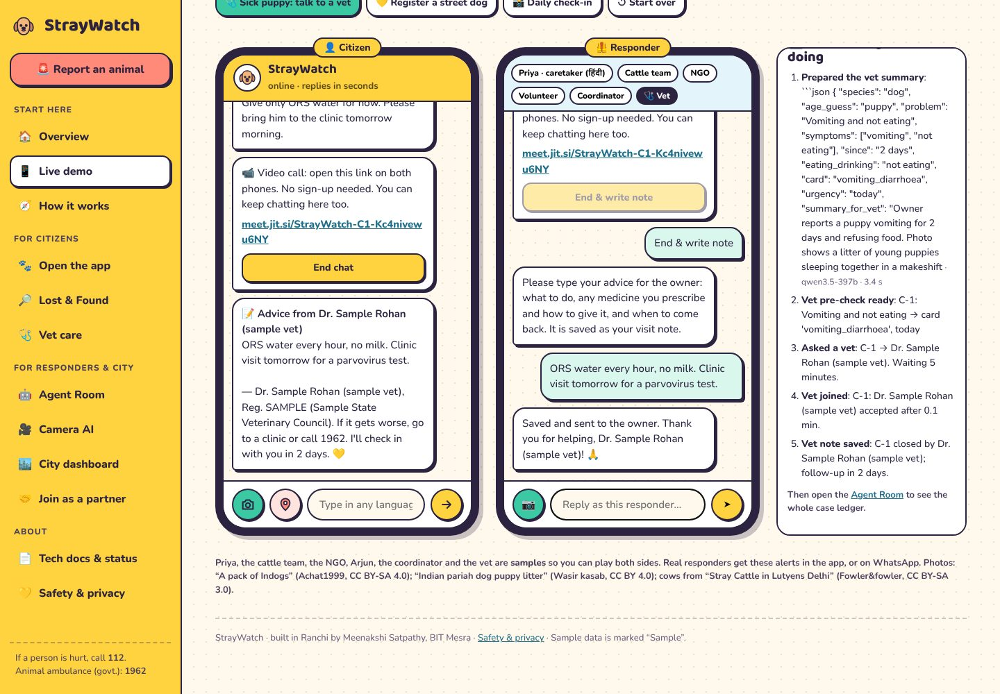
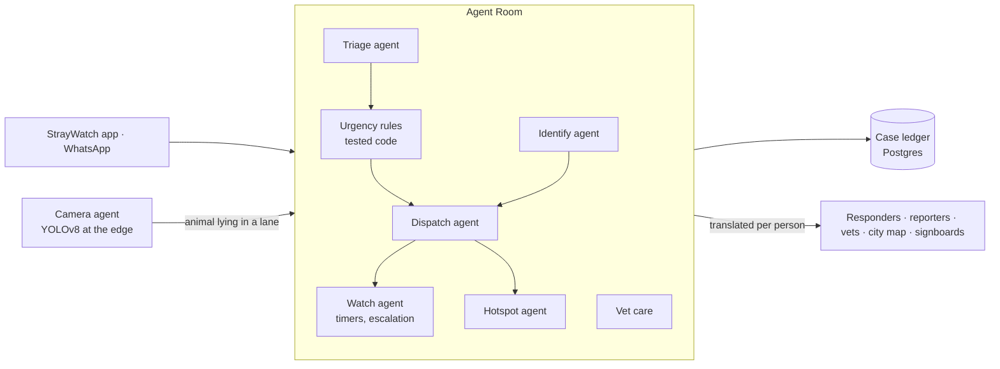

<p align="center"></p>

# 🐾 StrayWatch

**One photo, in your language, brings the nearest rescuer or vet to an injured animal in seconds.**

Built for the **BharatCode Build League** · AI runs on the **BharatCode model API** (`qwen3.5-397b`, `gemma-4-31b-it`) ·
[how we use it ↓](#how-straywatch-uses-the-bharatcode-model-api)

On my way to college in Ranchi I saw an injured dog lying on the road while vehicles kept passing it. Nobody called
anyone, because nobody knew whom to call. That happens every day on Indian roads: animals are hit or fall sick, help
reaches them late, and an injured animal lying in a lane becomes the next accident. Rescuers, vets and city teams exist;
they just find out too late, without a photo or an exact location, and nobody owns the case.

<p>
<a href="https://straywatch-cacyarcncugkf3cr.indiasouthcentral-01.azurewebsites.net"></a>
<a href="https://straywatch-cacyarcncugkf3cr.indiasouthcentral-01.azurewebsites.net/video"></a>


</p>

**Try it in 60 seconds:** open the [live demo](https://straywatch-cacyarcncugkf3cr.indiasouthcentral-01.azurewebsites.net/demo) → tap *Hurt dog (Hinglish)* →
watch the AI read it, the rules set **URGENT**, and the caretaker's phone (right) get the alert in Hindi.

🌐 [Website](https://straywatch-cacyarcncugkf3cr.indiasouthcentral-01.azurewebsites.net) · 📱 [App](https://straywatch-cacyarcncugkf3cr.indiasouthcentral-01.azurewebsites.net/app) ·
▶ [Demo video](https://straywatch-cacyarcncugkf3cr.indiasouthcentral-01.azurewebsites.net/video) · 🤖 [Agent Room](https://straywatch-cacyarcncugkf3cr.indiasouthcentral-01.azurewebsites.net/room) ·
📄 [Tech docs](https://straywatch-cacyarcncugkf3cr.indiasouthcentral-01.azurewebsites.net/docs)

---

## One journey, three parts

StrayWatch follows an animal from the moment it is hurt to the day it is healthy again, and makes the road safer so it
happens less. Each part feeds the next:

```text
  🚨 RESCUE  ───────────▶  🩺 TREATMENT  ───────────▶  🛣️ FEWER ACCIDENTS
  photo → right person      verified vet, booking,      hotspots, driver warnings,
  nearby in seconds         food & aftercare            lost & found
        ▲                                                        │
        └──────── every closed case teaches the city map ────────┘
```

### 🚨 1. Rescue (the core)

A citizen sends a photo, a few words or a typed landmark; a road camera can also spot an animal **lying** in a lane.
The AI reads it, **tested rules** set the urgency, and the right person nearby is alerted: the animal's caretaker first,
then a rescue NGO and a vet, the municipal cattle team for cows, and traffic police to guard the spot on busy roads.
No reply in 3 minutes? It moves on by itself, then to the duty coordinator. A case closes only with a **photo proof**
the AI checks, and the reporter follows every step on a private tracking link.

*For rescuers:* a private chat with the reporter (no numbers shared), *open cases near me*, a *Need transport* request,
and animal hospitals near the spot. New helpers are **approved by a coordinator** before they see any location.

### 🩺 2. Treatment (what happens after the rescue)

- **Talk to a verified vet:** an AI pre-check writes a one-page summary for the vet and shows a vet-reviewed care card
  (what to do now, what not to do). Emergencies go to a clinic or the government animal ambulance **1962** first.
  Each side reads the chat in their own language; StrayWatch checks in after 2 days.
- **Book a vet:** video or clinic visit, 30-minute slots that can never be double-booked.
- **Food & recovery:** vaccination schedules, “Can I feed this?”, and good generic food, delivered pay-on-delivery,
  including a **street-dog feeding pack** sent to a volunteer feeder.

### 🛣️ 3. Fewer accidents (so it happens less)

- **Driver warnings** on signboards while an injured animal is on the road.
- **Hotspot agent:** where and when animals keep getting hurt, by road and hour, so the city can add lights, speed
  breakers or signs.
- **Lost & Found:** a lost cow or dog is matched against every photo people send nearby; posters never show the
  owner's number.

### Why all three belong together (and how it pays for itself)

Rescue alone ends at “the animal reached a vet”; the vet and food parts make sure it actually recovers, and the city
map stops the next one. The same parts keep the rescue free: **paid pet consults and food orders** (pay on delivery)
plus **city dashboards** and CSR/NGO grants fund a rescue service that stays **free forever for citizens and rescuers**.

**Scope:** healthy animals standing, eating or wandering are **not** cases: nobody is sent, and StrayWatch never removes
healthy strays. It follows the Animal Birth Control Rules, 2023.

## Urgency rules (plain code, unit-tested)

| Level | When | Who is asked |
|---|---|---|
| 🔴 **URGENT** (3 min per responder) | Injured, sick, trapped or lying animal **on the road** · dead animal on the road · trapped anywhere | Caretaker → rescue NGO → vet → municipal cattle team (cows) → traffic police (busy road) → volunteers → duty coordinator |
| 🟡 **Needs care** (10 min per responder) | Injured or sick off the road · lying in a lane, condition unclear | Same order |
| ⚪ **No case** | Healthy animal, on the road or not | Nobody; counted for the traffic map only |

The AI only fills in facts (species, hurt?, on the road?, lying?). The person on the spot always wins: if they say it's
hurt, it's treated as hurt; if the photo is unclear, StrayWatch asks instead of guessing.

## Screenshots

| | |
|---|---|
|  |  |
| **Overview** (chat button bottom-right on every page) | **The idea in one line, what's new, today vs StrayWatch** |
|  |  |
| **Live demo:** a Hinglish SOS; the responder's phone gets the alert | **Vet care:** verified vets online, emergencies to 1962 |
|  |  |
| **Vet consult:** pre-check, care card, a verified vet joins | **Agent Room:** every case and its ledger, live |
|  |  |
| **City dashboard:** map, injury hotspots | **Camera AI** and driver signboards |

<p align="center">


<br>
<b>The app in Hindi and Tamil · a reporter's tracking page · a bilingual lost poster</b></p>

## Real use vs the demo

- **Citizens:** open the site and tap **Report an animal** (or the 💬 chat button on any page), or install it from
  `/app` like an app. No sign-up. Each report goes only to **real people who joined nearby**: volunteers (type
  *volunteer* in the chat), NGOs, city teams and verified vets.
- **If nobody has joined near you yet,** StrayWatch says so at once, and tells you to call **1962** (government
  animal ambulance). It keeps the case open and alerts the first rescuer who joins nearby. It never pretends someone
  is coming.
- **The `/demo` page is sealed:** the labelled sample responders and sample vets answer only demo reports. A real
  report never waits on a sample account, and demo cases never merge with real ones.

## Built for real people

- **6 languages, end to end:** English, हिंदी, বাংলা, தமிழ், తెలుగు, मराठी: app labels, chat, tracking page, posters,
  and the rules themselves (what people type in their own script is understood). Fixed messages are pre-translated in
  [`data/translations.json`](data/translations.json) so menus and safety cards work even if the AI is slow.
- **No GPS? No problem:** type a landmark (“Lalpur Chowk, Ranchi”); it's found on the map and confirmed before use.
  StrayWatch never invents a location.
- **Weak networks:** photos are shrunk on the phone (5 MB → ~0.5 MB); reports made offline are saved and sent
  automatically when the network returns.
- **Phone notifications** reach responders and reporters even when the app is closed. Installable, no app store.
- **Safe by design:** the AI never sets urgency, never diagnoses, never names a medicine or dose. Only verified vets
  advise. Phone numbers are never shared; public maps show areas of ~1 km, never homes.

## How it works



| Part | Model / tool |
|---|---|
| Triage, Identify, proof check, vet pre-check | BharatCode model API (`qwen3.5-397b`, `gemma-4-31b-it`), see [below](#how-straywatch-uses-the-bharatcode-model-api) |
| Camera agent | YOLOv8n + ByteTrack + OpenCV at the edge, 1–2 fps (`edge/camera_agent.py`) |
| Rules, dispatch, timers, ledger | Python, FastAPI, SQLAlchemy (Postgres in production, SQLite locally) |
| App and website | Installable PWA, Web Push, Leaflet + OpenStreetMap, Three.js (only on capable devices) |

Code map: `app/rules.py` (urgency rules) · `app/engine.py` (conversations, dispatch, escalation, ledger) · `app/vet.py`
(Vet Care) · `app/care.py` (booking slots, shop catalogue, vaccine schedules) · `app/words.py` (words in 6 languages) · `app/ai.py` (every model call) · `app/push.py` (notifications) ·
`app/geo.py` (landmarks) · `edge/camera_agent.py` · `data/` (care cards, food guide, translations, cameras).

## How StrayWatch uses the BharatCode model API

Every model call goes through the BharatCode (Adaption) **Responses API** with the official `adaption` Python SDK, in
one place: [`app/ai.py`](app/ai.py). Two hosted models, each picked for the job:

| Job | Model | Where in the journey | What it returns |
|---|---|---|---|
| Read a report (photo + Hinglish / any of 5 Indian scripts) | `qwen3.5-397b` (vision) | 🚨 Rescue | Species, injuries, on the road?, blocking a lane?, lying still?, markings: strict JSON, ~2–3 s |
| Recognise a registered animal among look-alikes | `qwen3.5-397b` (vision) | 🚨 Rescue | Which caretaker to alert first, with confidence (~1.2 s) |
| Check the rescuer's proof photo | `gemma-4-31b-it` (vision) | 🚨 Rescue | Is the animal helped / road clear? Case closes only if yes |
| Vet pre-check: one-page summary for the vet | `qwen3.5-397b` (vision) | 🩺 Treatment | Problem, symptoms, since when, eating/drinking, which care card to show |
| Compare a check-in photo with the last one | `gemma-4-31b-it` (vision) | 🩺 Treatment | Visible changes for the health diary |
| Match lost-animal posters against new photos | `qwen3.5-397b` (vision) | 🛣️ Lost & Found | Likely matches nearby |
| Understand what someone wants in chat (when keywords don't match) | `gemma-4-31b-it` | Everywhere | Intent (SOS, vet, lost, volunteer…) |
| Translate every reply, chat line and poster | `qwen3.5-397b` | Everywhere | The person's own language, batch-translated |

**Design rule: the model reads and compares; plain code decides.** Urgency, who gets alerted, the helper radius, the
3-minute escalation timers, privacy and confidence thresholds are all tested Python, never the model. Every reply is
validated field by field; if a call fails or the JSON is unusable, StrayWatch uses safe defaults (a reported SOS is
still treated as urgent) instead of guessing. Calls retry with back-off on rate limits and run through a small
concurrency cap. **Every call is timed and shown live** in the AI trace on the [demo page](https://straywatch-cacyarcncugkf3cr.indiasouthcentral-01.azurewebsites.net/demo):
step, model and milliseconds.

## Measured

| Test | Result |
|---|---|
| Triage reads a photo + message | ~2–3 s; Hinglish and all 5 Indian scripts understood |
| Re-identification of 11 animals among look-alikes | 11/11, ~1.2 s each (edited copies of photos) |
| Report → caretaker alerted | ~10 s on the free live server |
| Camera agent | Alert for dogs lying on a road; 0 alerts for healthy cows walking on real road video; ~35 ms per frame on a 4-core CPU |
| Two-city load test (1,238 reports) | Every case got a responder; 0 alerts beyond 8 km or to the wrong city; daily cap held |
| Automated tests | 101, run in GitHub Actions |

Honest limits: the responder teams and vets on the live site are **samples** until real partners join (bookings with a
sample vet are clearly marked as demo bookings); food orders are confirmed by phone and paid on delivery, with no online
payment yet; the camera model is pretrained (not yet fine-tuned on Indian night footage); care cards await review by a
partner vet.

## Run it

```bash
pip install -r requirements.txt
export ADAPTION_API_KEY=...                 # BharatCode model API key
uvicorn app.main:app --reload               # http://localhost:8000
python -m pytest -q tests                   # offline tests with a stand-in AI
```

Demo mode (on by default) seeds clearly labelled sample responders, vets, animals and cases around Ranchi.
Optional settings: `SW_ADMIN_KEY` (verify vets at `/admin/vets`, orders and bookings at `/admin/orders`, new helpers at `/admin/helpers`), `SW_AGENT_KEY` (camera agents),
`WHATSAPP_*` (WhatsApp add-on). See [`.env.example`](.env.example).

**Deploy:** Render → New → Blueprint → this repo ([`render.yaml`](render.yaml)); add `ADAPTION_API_KEY` and a Postgres
`DATABASE_URL`. A paid always-on instance is recommended for real use. On the free plan, the [`keep-awake`](.github/workflows/keep-awake.yml) workflow pings `/health` every 10 minutes so the first SOS doesn't wait for the server to wake.

**Deploy on Azure App Service** (Linux, Python 3.12, Basic B1 or higher): set the startup command to
`uvicorn app.main:app --host 0.0.0.0 --port 8000`, turn on *Always On*, add `ADAPTION_API_KEY` and
`SCM_DO_BUILD_DURING_DEPLOYMENT=true`, and connect this repo in *Deployment Center*. The address and a SQLite file
under `/home` are picked up automatically (or set `DATABASE_URL` to a Postgres database).

**Camera on an edge box:** `pip install -r edge/requirements-edge.txt`, then
`python edge/camera_agent.py --video rtsp://… --camera ratu-rd-01 --server https://… --key $SW_AGENT_KEY`.

## Credits

Demo photos are openly licensed from Wikimedia Commons (authors and licences in
[`data/demo_photos/credits.json`](data/demo_photos/credits.json)); road footage “Stray Cattle in Lutyens Delhi”
(Fowler&fowler, CC BY-SA 3.0). First-aid and care guidance is adapted from People For Animals, Humane World for
Animals, Blue Cross, FIAPO, the Department of Animal Husbandry & Dairying, ASPCA and WHO (links in `data/`).
Maps © OpenStreetMap contributors. Doodles and design are original to this project.

Made with 💛 in Ranchi.
