<p align="center">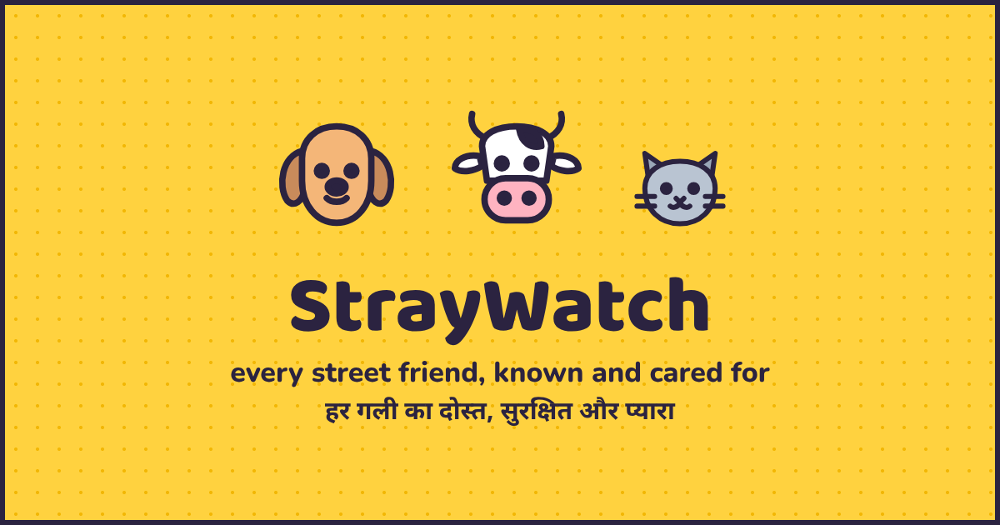</p>

# 🐾 StrayWatch

**Help for every injured animal, a vet for every animal, and fewer accidents on our roads.**

Every day on Indian roads, stray and community animals are hit, injured or fall sick, and help reaches them late.
People don't know whom to call; rescuers and vets find out without a photo or an exact location; nobody owns the case.
And an injured animal lying on the road becomes the next accident. StrayWatch fixes that: **send one photo (or a few
words, in your language) and the right responder nearby is alerted in seconds**, with every step tracked until the
animal is safe. Pet owners and caretakers can also **talk to a verified vet online**.

<p>
<a href="https://straywatch-0h6w.onrender.com"></a>
<a href="https://straywatch-0h6w.onrender.com/video"></a>


</p>

🌐 **[Website](https://straywatch-0h6w.onrender.com)** · 📱 **[Open the app](https://straywatch-0h6w.onrender.com/app)** ·
▶ [Demo video](https://straywatch-0h6w.onrender.com/video) · 🎬 [Live demo](https://straywatch-0h6w.onrender.com/demo) ·
🩺 [Vet care](https://straywatch-0h6w.onrender.com/vet) · 📅 [Book a vet](https://straywatch-0h6w.onrender.com/vet/book) ·
🛒 [Food & nutrition](https://straywatch-0h6w.onrender.com/shop) · 🤖 [Agent Room](https://straywatch-0h6w.onrender.com/room) ·
📄 [Tech docs](https://straywatch-0h6w.onrender.com/docs)

**Try it in 60 seconds:** open the [live demo](https://straywatch-0h6w.onrender.com/demo) → tap *Hurt dog (Hinglish)* →
watch the AI read it, the rules set **URGENT**, and the caretaker's phone (right) get the alert in Hindi.

> The free server sleeps when idle, so the first visit can take up to a minute to wake up.

---

## What it does

| | What happens |
|---|---|
| 🚨 **Rescue** | A citizen sends a photo, a few words or a typed landmark; a road camera can also spot an animal **lying** in a lane. The AI reads it, **tested rules** set the urgency, and the right responder is alerted: the animal's caretaker first, then a rescue NGO and a vet; the municipal cattle team for cows; traffic police to guard the spot on busy roads. No reply? It moves on by itself, then to the duty coordinator. Closed only with a **photo proof** the AI checks. The reporter follows every step on a private tracking link. **For rescuers:** a private chat with the reporter (no numbers shared), an *open cases near me* list to pick up waiting cases, a *Need transport* request to NGOs and city teams, and animal hospitals near the spot. New helpers are **approved by a coordinator** before they see any animal's location. |
| 🩺 **Vet care** | For a pet or a street animal: a short AI pre-check prepares a **one-page summary for the vet**, shows a **vet-reviewed care card** (what to do now, what not to do), and sends emergencies to a clinic or the government animal ambulance **1962** first. Then a **verified vet** joins a live chat (each side reads in their own language, photos, a video link), writes a note, and StrayWatch checks in after 2 days. Food guide and “Can I feed this?” included. |
| 📅 **Book a vet** | Pick a verified vet, video consult or clinic visit, a day and a free 30-minute slot. The vet gets the summary in their chat; the owner gets a booking page with the video link and can cancel anytime. A slot can never be double-booked. |
| 🛒 **Food & nutrition** | Generic, good-quality food for dogs, puppies, cats, kittens and cattle (mineral mixture, balanced feed), bowls and a **street-dog feeding pack** delivered to a volunteer feeder. Priced on the server, confirmed by phone, **pay on delivery**. Vaccination schedules for dogs, cats and cows on the vet page. |
| 🛣️ **Fewer accidents** | Signboard warnings for drivers while an injured animal is on the road; a **Hotspot agent** finds where animals keep getting hurt, by road and hour, so the city can add lights, speed breakers or signs. |
| 🔎 **Lost & Found** | A lost cow or dog is matched against every photo people sent nearby, and every new one; bilingual posters never show the owner's number. |

**Scope:** healthy animals standing, eating or wandering are **not** cases: nobody is sent, and StrayWatch never removes
healthy strays. It follows the Animal Birth Control Rules, 2023.

## Urgency rules (plain code, unit-tested)

| Level | When | Who is asked |
|---|---|---|
| 🔴 **URGENT** (3 min per responder) | Injured, sick, trapped or lying animal **on the road** · dead animal on the road · trapped anywhere | Caretaker → rescue NGO → vet → municipal cattle team (cows) → traffic police (busy road) → volunteers → duty coordinator |
| 🟡 **Needs care** (10 min per responder) | Injured or sick off the road · lying in a lane, condition unclear | Same order |
| ⚪ **No case** | Healthy animal, on the road or not | Nobody; counted for the traffic map only |

The AI only fills in facts (species, hurt?, on the road?, lying?). The person on the spot always wins: if they say it's
hurt, it's treated as hurt; if the photo is unclear, StrayWatch asks instead of guessing.

## Screenshots

| | |
|---|---|
| 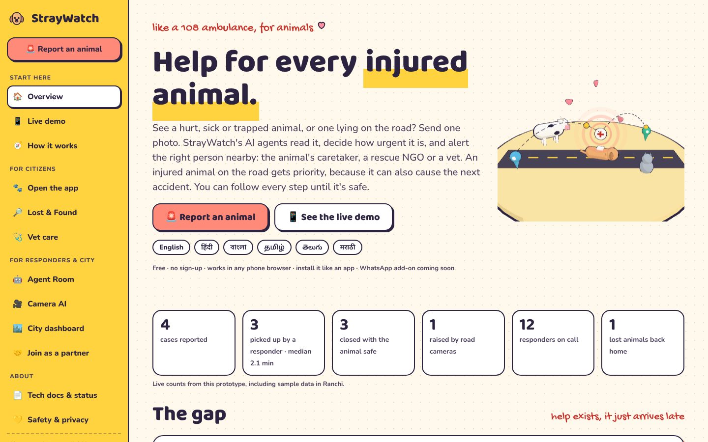 | 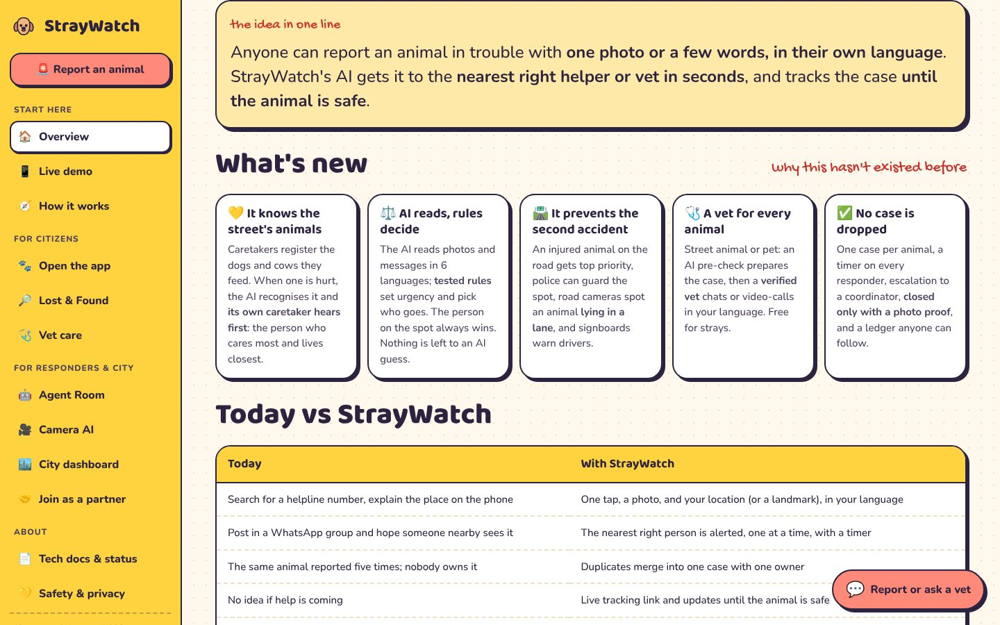 |
| **Overview** (chat button bottom-right on every page) | **The idea in one line, what's new, today vs StrayWatch** |
| 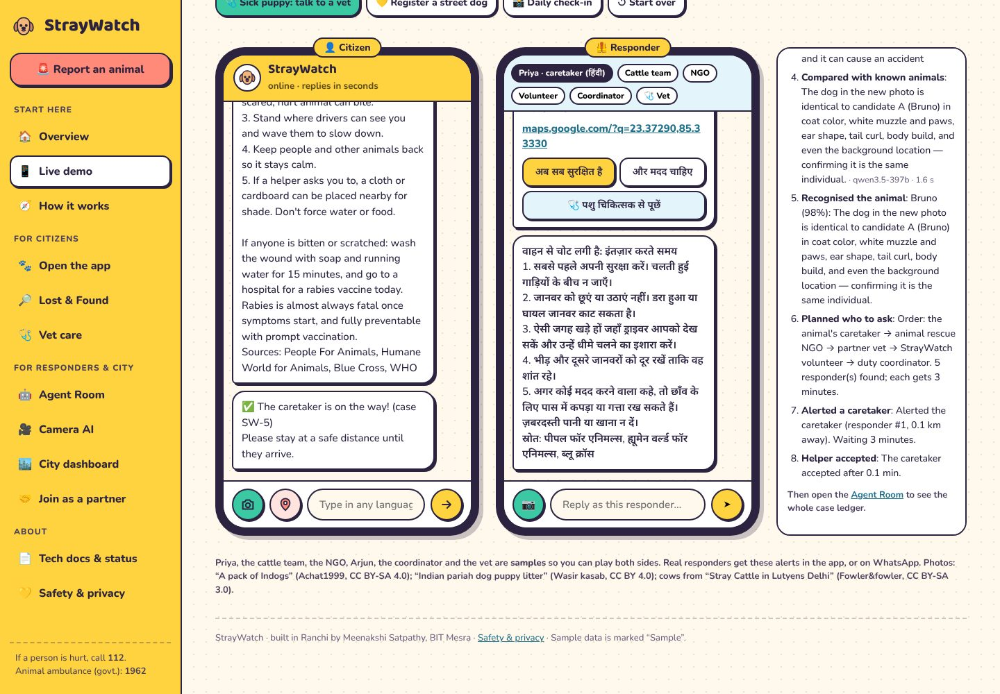 | 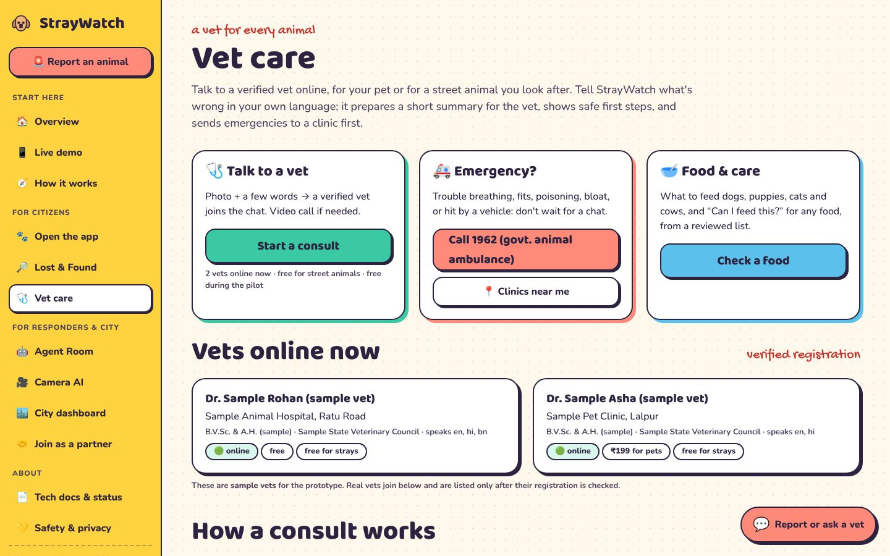 |
| **Live demo:** a Hinglish SOS; the responder's phone gets the alert | **Vet care:** verified vets online, emergencies to 1962 |
|  | 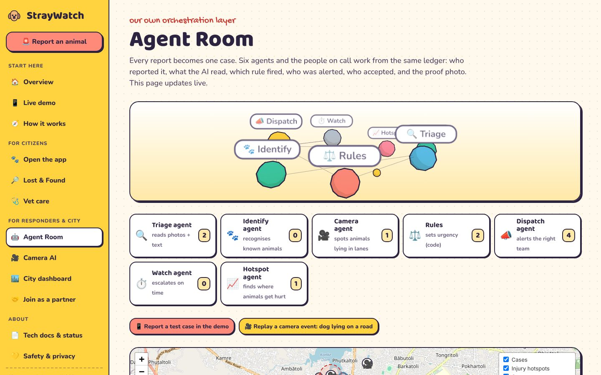 |
| **Vet consult:** pre-check, care card, a verified vet joins | **Agent Room:** every case and its ledger, live |
| 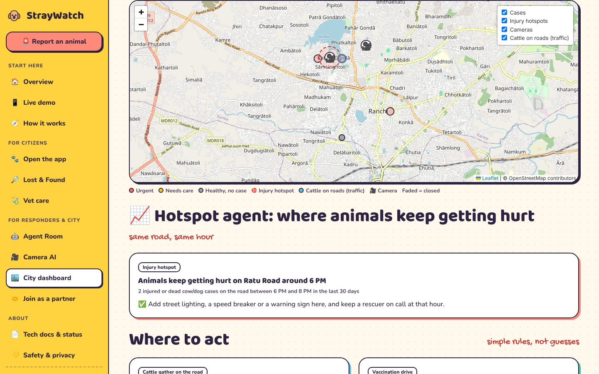 | 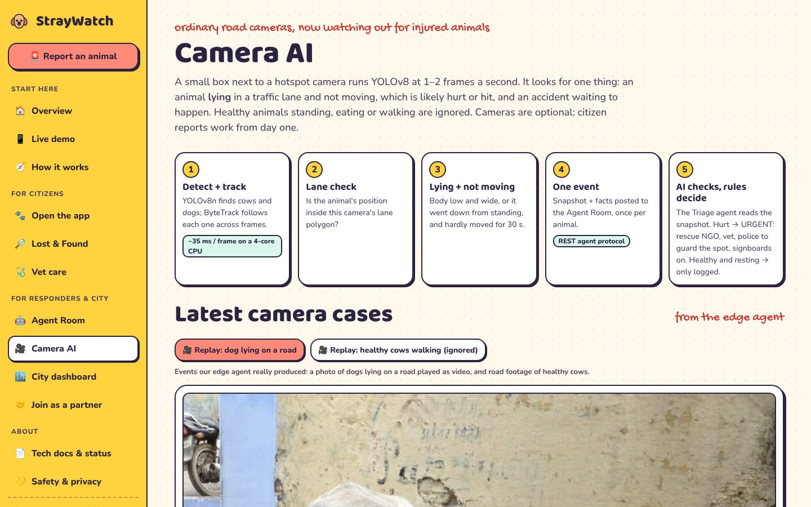 |
| **City dashboard:** map, injury hotspots | **Camera AI** and driver signboards |

<p align="center">
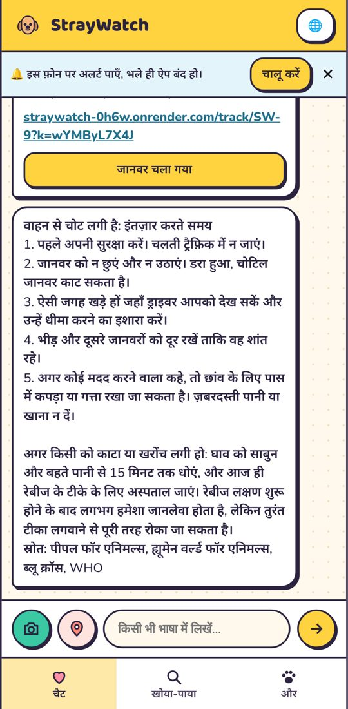
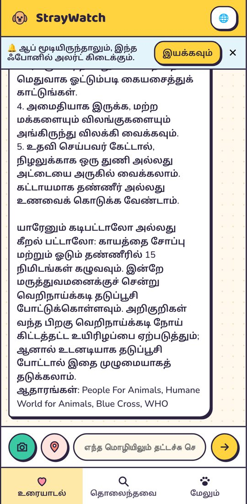
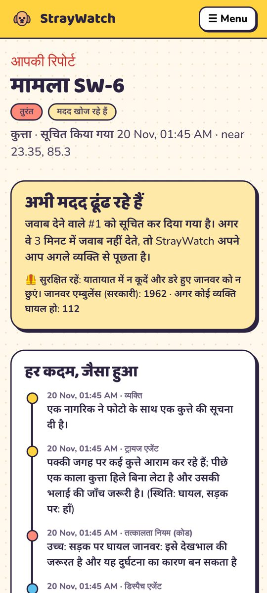
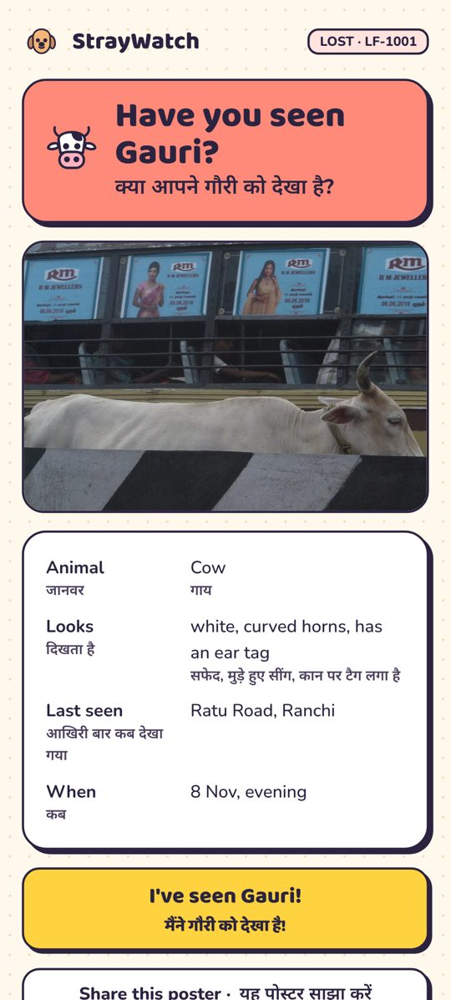<br>
<b>The app in Hindi and Tamil · a reporter's tracking page · a bilingual lost poster</b></p>

## Real use vs the demo

- **Citizens:** open the site and tap **Report an animal** (or the 💬 chat button on any page), or install it from
  `/app` like an app. No sign-up. Each report goes only to **real people who joined nearby**: volunteers (type
  *volunteer* in the chat), NGOs, city teams and verified vets.
- **If nobody has joined near you yet,** StrayWatch says so at once, and tells you to call **1962** (government
  animal ambulance). It keeps the case open and alerts the first rescuer who joins nearby. It never pretends someone
  is coming.
- **The `/demo` page is sealed:** the labelled sample responders and sample vets answer only demo reports. A real
  report never waits on a sample account, and demo cases never merge with real ones.

## Built for real people

- **6 languages, end to end:** English, हिंदी, বাংলা, தமிழ், తెలుగు, मराठी: app labels, chat, tracking page, posters,
  and the rules themselves (what people type in their own script is understood). Fixed messages are pre-translated in
  [`data/translations.json`](data/translations.json) so menus and safety cards work even if the AI is slow.
- **No GPS? No problem:** type a landmark (“Lalpur Chowk, Ranchi”); it's found on the map and confirmed before use.
  StrayWatch never invents a location.
- **Weak networks:** photos are shrunk on the phone (5 MB → ~0.5 MB); reports made offline are saved and sent
  automatically when the network returns.
- **Phone notifications** reach responders and reporters even when the app is closed. Installable, no app store.
- **Safe by design:** the AI never sets urgency, never diagnoses, never names a medicine or dose. Only verified vets
  advise. Phone numbers are never shared; public maps show areas of ~1 km, never homes.

## How it works

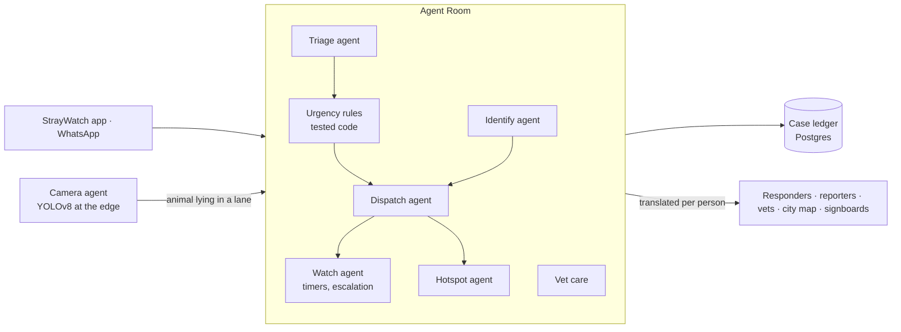

| Part | Model / tool |
|---|---|
| Triage, Identify, proof check, vet pre-check | Vision LLM via the BharatCode model API (`qwen3.5-397b`, `gemma-4-31b-it`), strict JSON validated field by field |
| Camera agent | YOLOv8n + ByteTrack + OpenCV at the edge, 1–2 fps (`edge/camera_agent.py`) |
| Rules, dispatch, timers, ledger | Python, FastAPI, SQLAlchemy (Postgres in production, SQLite locally) |
| App and website | Installable PWA, Web Push, Leaflet + OpenStreetMap, Three.js (only on capable devices) |

Code map: `app/rules.py` (urgency rules) · `app/engine.py` (conversations, dispatch, escalation, ledger) · `app/vet.py`
(Vet Care) · `app/care.py` (booking slots, shop catalogue, vaccine schedules) · `app/words.py` (words in 6 languages) · `app/ai.py` (every model call) · `app/push.py` (notifications) ·
`app/geo.py` (landmarks) · `edge/camera_agent.py` · `data/` (care cards, food guide, translations, cameras).

## Measured

| Test | Result |
|---|---|
| Triage reads a photo + message | ~2–3 s; Hinglish and all 5 Indian scripts understood |
| Re-identification of 11 animals among look-alikes | 11/11, ~1.2 s each (edited copies of photos) |
| Report → caretaker alerted | ~10 s on the free live server |
| Camera agent | Alert for dogs lying on a road; 0 alerts for healthy cows walking on real road video; ~35 ms per frame on a 4-core CPU |
| Two-city load test (1,238 reports) | Every case got a responder; 0 alerts beyond 8 km or to the wrong city; daily cap held |
| Automated tests | 101, run in GitHub Actions |

Honest limits: the responder teams and vets on the live site are **samples** until real partners join (bookings with a
sample vet are clearly marked as demo bookings); food orders are confirmed by phone and paid on delivery, with no online
payment yet; the camera model is pretrained (not yet fine-tuned on Indian night footage); care cards await review by a
partner vet.

## Run it

```bash
pip install -r requirements.txt
export ADAPTION_API_KEY=...                 # BharatCode model API key
uvicorn app.main:app --reload               # http://localhost:8000
python -m pytest -q tests                   # offline tests with a stand-in AI
```

Demo mode (on by default) seeds clearly labelled sample responders, vets, animals and cases around Ranchi.
Optional settings: `SW_ADMIN_KEY` (verify vets at `/admin/vets`, orders and bookings at `/admin/orders`, new helpers at `/admin/helpers`), `SW_AGENT_KEY` (camera agents),
`WHATSAPP_*` (WhatsApp add-on). See [`.env.example`](.env.example).

**Deploy:** Render → New → Blueprint → this repo ([`render.yaml`](render.yaml)); add `ADAPTION_API_KEY` and a Postgres
`DATABASE_URL`. A paid always-on instance is recommended for real use, so the first SOS never waits for the server to wake.

**Camera on an edge box:** `pip install -r edge/requirements-edge.txt`, then
`python edge/camera_agent.py --video rtsp://… --camera ratu-rd-01 --server https://… --key $SW_AGENT_KEY`.

## Credits

Demo photos are openly licensed from Wikimedia Commons (authors and licences in
[`data/demo_photos/credits.json`](data/demo_photos/credits.json)); road footage “Stray Cattle in Lutyens Delhi”
(Fowler&fowler, CC BY-SA 3.0). First-aid and care guidance is adapted from People For Animals, Humane World for
Animals, Blue Cross, FIAPO, the Department of Animal Husbandry & Dairying, ASPCA and WHO (links in `data/`).
Maps © OpenStreetMap contributors. Doodles and design are original to this project.

Made with 💛 in Ranchi.
