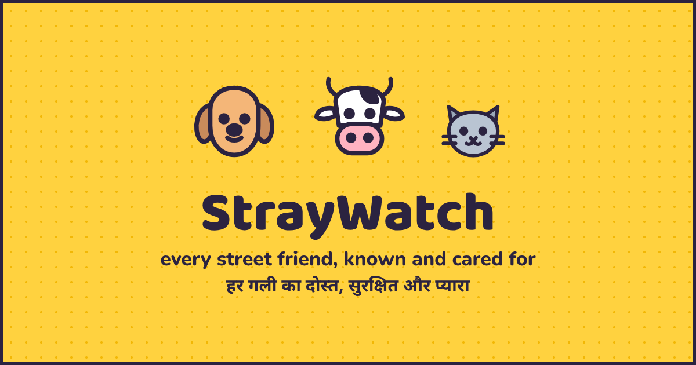
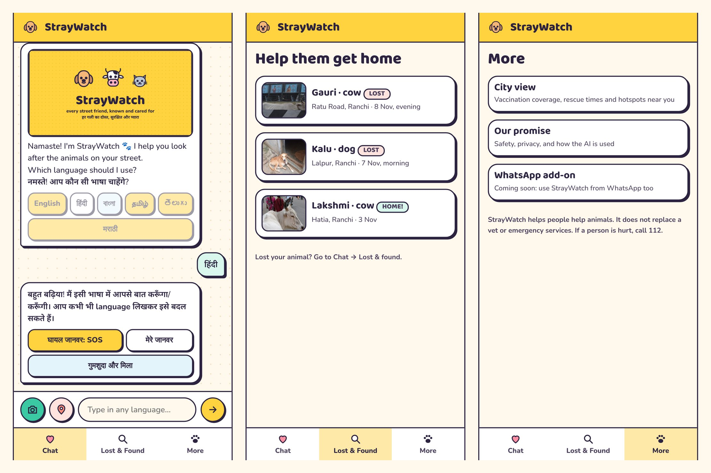
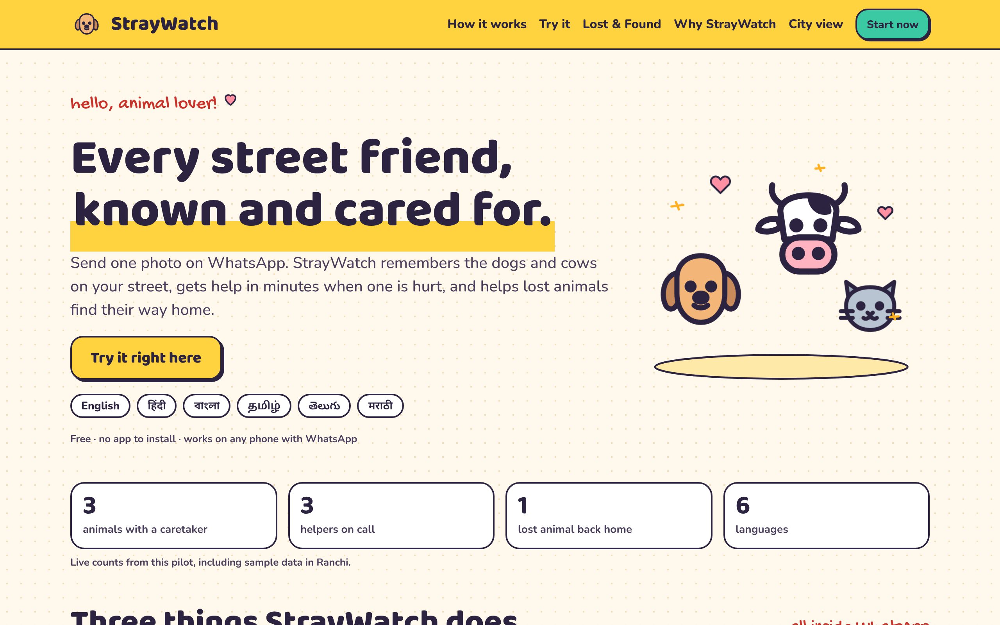
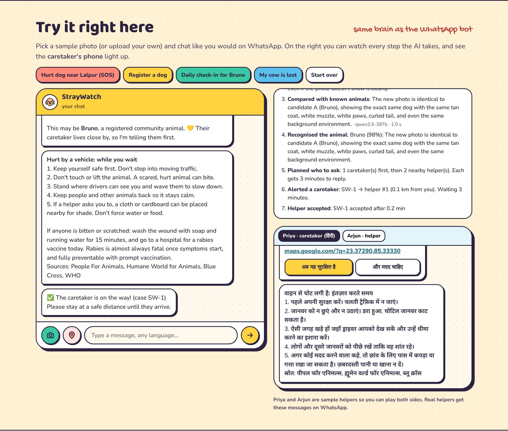
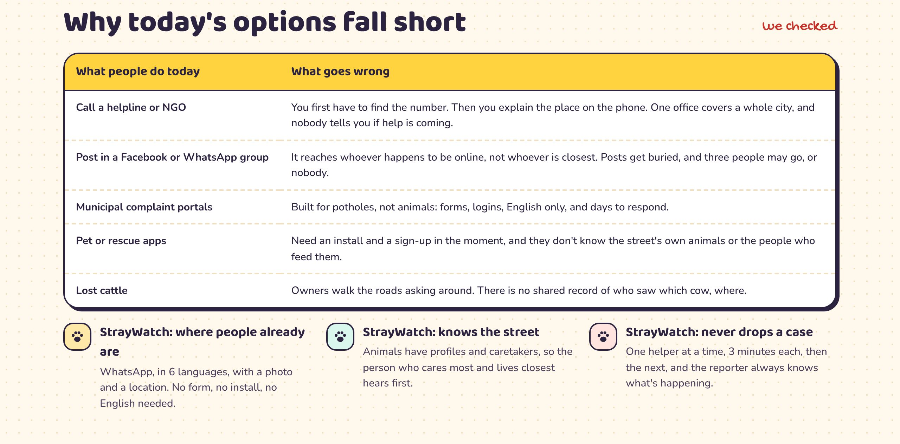
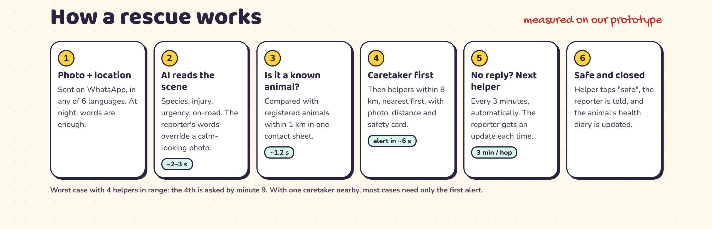
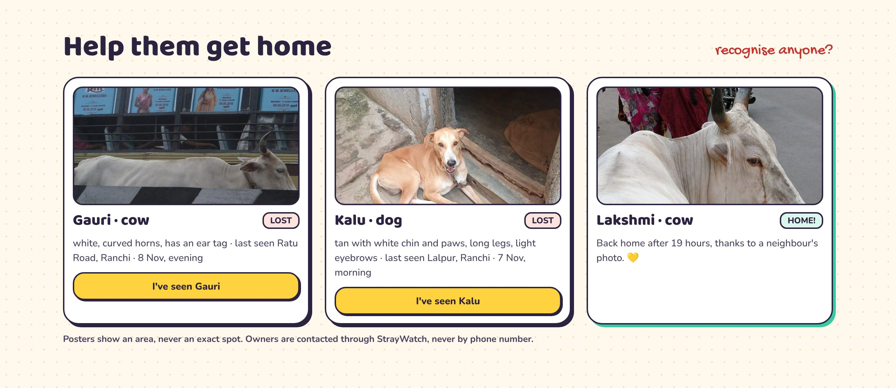
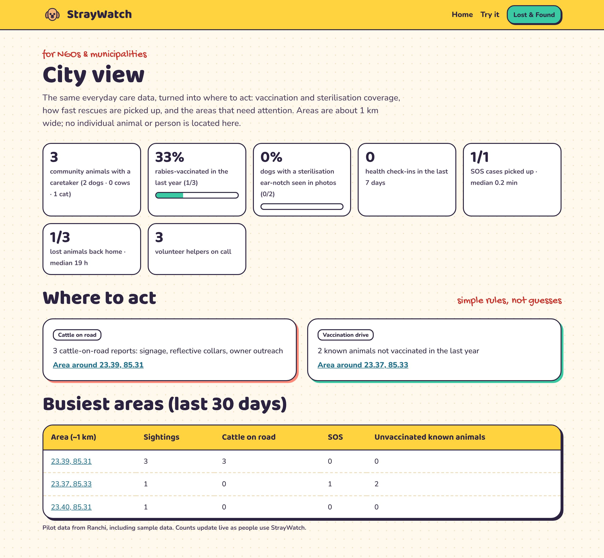
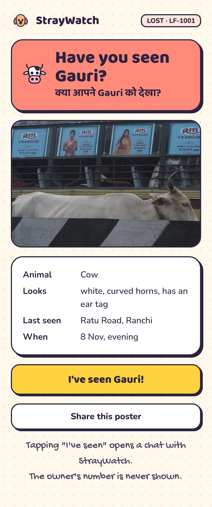
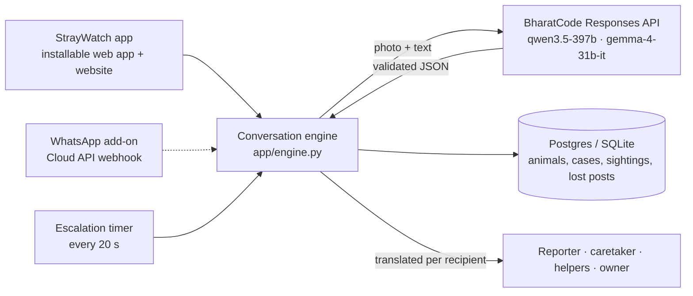

<p align="center"></p>

# 🐾 StrayWatch

**Every street friend, known and cared for.** A free, installable mobile web app for the people who look after India's
community dogs and cows, with an optional WhatsApp add-on, powered by the **BharatCode model API**.

> Send one photo. StrayWatch remembers the animals on your street, gets help in minutes when one is hurt, and helps
> lost cows and dogs find their way home, in English, हिंदी, বাংলা, தமிழ், తెలుగు or मराठी.

🌐 **Live: [straywatch-0h6w.onrender.com](https://straywatch-0h6w.onrender.com)** · 📱 **[Open the app](https://straywatch-0h6w.onrender.com/app)** · 🏙️ [City view](https://straywatch-0h6w.onrender.com/city) · 🧪 `11 tests passing`

> The free server sleeps when idle, so the first visit can take up to a minute to wake up.
>
> **Status:** the app and website run live: open [/app](https://straywatch-0h6w.onrender.com/app) on a phone and
> "Add to home screen". The WhatsApp add-on is built and tested with simulated Meta webhooks; going live on a WhatsApp
> number is waiting on Meta business verification.

---

## Why

On my way to college in Ranchi I see it every day: a dog limping near a signal, a cow standing in the middle of the
main road at night. People here care, and every street has someone who feeds these animals. But when something goes
wrong, **nobody knows whom to call**, help arrives late, and a cow that wandered off is never found.

| | |
|---|---|
| **1.53 crore** street dogs and **~50 lakh** stray cattle in India | [20th Livestock Census, 2019 (PIB)](https://pib.gov.in/PressReleasePage.aspx?PRID=1813802) |
| **37 lakh** dog-bite cases reported in 2024 | [NCDC data via Lok Sabha reply](https://www.dailyexcelsior.com/?p=2029854) |
| Dogs **69%** and cattle **21%** of stray-animal road-crash cases at one trauma centre | [J Emerg Trauma Shock, 2021](https://pmc.ncbi.nlm.nih.gov/articles/PMC8054802) |

Rescue apps wait for an emergency, so people install them once and forget them. **StrayWatch builds the community
before the emergency**: caretakers use it daily for the animals they already feed, and that daily habit is what
makes rescue fast and lost animals findable.

## What it does

| | For whom | What happens |
|---|---|---|
| 🐶 **My Animals** | Feeders and caretakers, **daily** | One photo makes a profile (colour, markings, sterilisation ear-notch). A photo at feeding time is **recognised as the right animal**, logged in a health diary, compared with the last photo for visible changes, with rabies-vaccine reminders. |
| 🚨 **Rescue SOS** | Anyone who sees a hurt animal | Photo (or words at night) + location → AI triage → if it's a registered animal, **its caretaker is alerted first**, then the nearest volunteers. **No reply in 3 minutes → it moves on by itself** and keeps the reporter updated. Safety-first first aid with sources. |
| 🔎 **Lost & Found** | Cattle and dog owners | Post a photo → the AI **searches every photo people sent nearby**, checks each new one against open posters, and pings the owner on a match. A shareable public poster never shows the owner's number or exact spot. |

It's a **mobile web app** that opens in any phone browser and installs to the home screen like a normal app, with no
app store. The same assistant can also be reached through an optional **WhatsApp add-on**. The **website** has a guided
demo with a live view of every AI step and a second phone showing the caretaker's side. A **City view** turns the same data
into where NGOs and municipalities should act: vaccination and sterilisation coverage, response times, and cattle
hotspots on roads.


## Screenshots

<p align="center"><br><b>The app on a phone</b> (installable from the browser, shown in Hindi)</p>

| | |
|---|---|
|  |  |
| **Homepage** | **Try it:** a Hinglish SOS; the caretaker's phone gets the alert in Hindi, and every AI step is shown |
|  |  |
| **Why today's options fall short** | **How a rescue works**, with measured timings |
|  |  |
| **Lost & Found board** | **City view** for NGOs and municipalities |

<p align="center"><br><b>Shareable lost poster</b> (no phone number, no exact spot)</p>

## How we used the BharatCode model API

StrayWatch is a **harness**: model + prompts + tools + workflow. Every model call goes through the BharatCode
(Adaption) **Responses API** using the official [`adaption`](https://pypi.org/project/adaption/) Python SDK
([`app/ai.py`](app/ai.py)).

| Job | Model (hosted on BharatCode) | How |
|---|---|---|
| **Read the scene**: species, injuries, urgency, on-road, sterilisation ear-notch, ear tag, first-aid card | `qwen3.5-397b` (vision) | Photo + the person's message (Hinglish, Hindi, Bengali…) → one strict JSON record, validated field by field ([`describe`](app/ai.py)) |
| **Recognise an individual animal** (check-ins, caretaker-first rescue, duplicate profiles) | `qwen3.5-397b` (vision) | New photo + a **labelled contact sheet** of nearby candidates (A, B, C…) in one call ([`match`](app/ai.py), [`contact_sheet`](app/photos.py)) |
| **Find lost animals** in past and future sightings | `qwen3.5-397b` (vision) | Same contact-sheet comparison against up to 18 nearby sightings from the last 14 days |
| **Notice health changes** between check-ins | `gemma-4-31b-it` (vision) | Old vs new photo → "changed / see a vet", never a diagnosis |
| **Understand free text** in any of the 6 languages | `gemma-4-31b-it` | Intent: SOS / lost / register / seen… (keywords first, model only when needed) |
| **Talk in the user's language** | `qwen3.5-397b` | Every reply translated in **one batched call per language**, cached, native script |

**Design rule: the AI reads and compares; plain code decides and enforces.** Helper radius, escalation timers, the
daily alert cap, privacy rounding and confidence thresholds are code the model can't talk its way around. For
example, if a reporter writes *"khoon aa raha hai"* (it's bleeding) but the photo looks calm, code keeps the case
**urgent**: a rescue tool must believe the person on the spot.

### What we learned about the API, and how we engineered around it
- **Reasoning budget.** `qwen3.5-397b` is a reasoning model. With default settings it spent the whole token budget
  thinking and returned nothing. We set `reasoning.effort = "none"` for reading jobs: **~2–3 s** per photo, accurate.
- **Images per request and rate limits.** Sending one photo per candidate was slow and hit the per-user rate limit.
  We tile candidates into **one labelled contact sheet**, so every comparison is exactly two images: **~1.2 s** for up
  to 9 candidates. Calls retry with back-off and are capped at 3 in parallel.
- **Look-alike animals.** Indian street dogs often share the "tan coat, white chest, curled tail" look. The prompt
  says common features don't count without a distinctive one, and StrayWatch only acts on its own at **95%+**
  confidence; anything lower is a question to a human ("Is this Bruno?").

### Measured (on this repo, Nov 2026)
| Test | Result |
|---|---|
| Scene reading: healthy dog, cow on road, cat, blank image, text-only Hinglish SOS | 5/5 correct; blank image rejected as "no animal"; text-only SOS → dog · injured · **high** |
| Re-identification: 11 animals, each shown again cropped, mirrored and darker among 5–6 look-alikes | **11/11** recognised, ~1.2 s each |
| Animal absent from candidates (should say "none") | 5/6 correct; the miss was two near-identical white cows, so matches always go to a human to confirm |
| Full SOS: report → triage → recognised as Bruno → caretaker alerted (in Hindi) → accepted → closed | ✅ about 6 s locally, about 10 s on the live free-tier server, from the location being shared to the caretaker's alert |
| Escalation: caretaker silent → next helper → "can't go" → third helper (in Bengali), reporter updated | ✅ |
| Lost & Found: lost cow posted → found in yesterday's sightings 1.6 km away → owner confirms → finder thanked | ✅ |

*Honest caveat:* the re-identification test uses edited copies of the same photo, which is easier than real life.
Real-world accuracy needs a pilot with real caretakers, which is our next step.

## Safety, privacy and ethics (built in, not bolted on)
- **The AI never writes medical advice.** It picks one of 10 reviewed first-aid cards
  ([`data/first_aid.json`](data/first_aid.json)) based on People For Animals, Humane World for Animals, Blue Cross
  and WHO, with sources shown. Every card starts with *don't touch, a scared animal can bite*, and the rabies rule
  (wash 15 min, vaccine today) is always included.
- **Private by default.** Phone numbers are never shared; owners, finders and helpers talk through the bot. Public
  posters show an area, never an exact spot. Photos are re-encoded, which strips hidden GPS data.
- **For animals, never against them.** There is no "remove this dog" flow. StrayWatch follows the spirit of India's
  Animal Birth Control Rules, 2023: care, vaccinate, sterilise.
- **Abuse-resistant.** Photos with no animal alert nobody. Duplicate reports of the same animal merge into one case.
  Helpers get alerts only within 8 km, at most 6 a day, and can type *pause*.
- **Not an emergency service.** If a person is hurt, call 112.

## Architecture

- `app/engine.py`: channel-agnostic flows (welcome, My Animals, SOS, Lost & Found); returns messages for many people
- `app/ai.py`: every BharatCode call, validation, retries and fallbacks
- `app/channels/whatsapp.py`: webhook, media download, buttons, lists, location requests
- `app/main.py`: website, the installable app (`/app`, manifest, service worker), public posters, City view,
  WhatsApp webhook, escalation loop
- `app/templates/`, `app/static/`: the doodle-style pages and the chat UI

## Run it
```bash
pip install -r requirements.txt
export ADAPTION_API_KEY=pt_live_...        # BharatCode / Adaption console → Settings → API keys
uvicorn app.main:app --reload              # http://localhost:8000
python -m pytest -q tests                  # 11 offline tests (stand-in AI)
```
Demo mode (on by default) seeds sample caretakers, animals and posters around Ranchi so the website works right away.

**Deploy:** Render → New → Blueprint → this repo ([`render.yaml`](render.yaml)). Add `ADAPTION_API_KEY`,
`PUBLIC_BASE_URL`, and a free Postgres `DATABASE_URL` (e.g. Neon). Point a free uptime monitor at `/health` so the
escalation timer keeps running.

**WhatsApp:** developers.facebook.com → create a Business app → add WhatsApp → copy the token and phone-number ID into
`WHATSAPP_TOKEN` and `WHATSAPP_PHONE_NUMBER_ID` → set the webhook to `https://<your-app>/webhook/whatsapp` with
verify token `straywatch-verify` and subscribe to `messages`. See [`.env.example`](.env.example).

## What's next
A pilot with feeders and a local NGO in Ranchi to measure real recognition accuracy and response times · WhatsApp
message templates so reminders can reach caretakers outside the 24-hour window · a ward dashboard for sterilisation
and vaccination coverage · night-time cattle hotspots for drivers.

## Credits
Demo photos are openly licensed from Wikimedia Commons; authors and licences are in
[`data/demo_photos/credits.json`](data/demo_photos/credits.json). First-aid guidance is adapted from People For
Animals, Humane World for Animals, Blue Cross and WHO (links in [`data/first_aid.json`](data/first_aid.json)).
Doodles and design are original to this project.

Made with 💛 in Ranchi.
